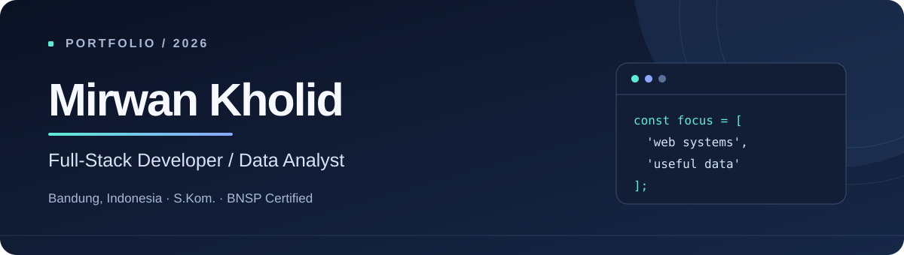

  

  

  
<em>🚀 Membangun produk digital yang membuat pekerjaan lebih sederhana, cepat, dan terukur.</em>

  

  
  
  
  
  
  

  

    
    
    
  

---

### 👨‍💻 Tentang saya

Saya **Mirwan Kholid**, pengembang web full-stack dan analis data bersertifikasi BNSP dari Bandung. Saya merancang aplikasi dari kebutuhan operasional hingga implementasi: alur kerja, basis data, antarmuka, integrasi, dan pelaporan. Pekerjaan saya banyak berfokus pada sistem layanan, transaksi, serta analitik yang bisa dipakai untuk mengambil keputusan.

- 🔭 **Proyek aktif:** Bank Sampah Sukamaju Sejahtera dan SIM KIPAN Indonesia.
- 💡 **Minat teknologi:** arsitektur web scalable, database relasional, analitik data, geofencing, dan WebGIS.
- ⚡ **Pengalaman:** membangun 8+ sistem untuk layanan publik, operasional bisnis, dan komunitas.
- 🎯 **Fokus:** menghubungkan kebutuhan operasional dengan aplikasi yang mudah digunakan dan hasil yang terukur.

---

### 🛠️ Tech Stack & Skills

  <h4>🌐 Frontend</h4>
  

    
    
    
    
    
    
  

  <h4>⚙️ Backend & Frameworks</h4>
  

    
    
    
    
    
    
  

  <h4>📊 Data Analytics & Visualisasi</h4>
  

    
    
    
    
    
    
  

  <h4>🗄️ Database & Developer Tools</h4>
  

    
    
    
    
    
    
  

---

### 🚀 Featured Systems & Projects

| **No** | **Project Name** | **Type / Client** | **Tech Stack** | **Repository / Live** |
| :---: | :--- | :--- | :--- | :--- |
| **01** | **Bank Sampah Sukamaju Sejahtera** | Undergraduate Thesis & Community Platform | Next.js, TypeScript, Prisma, MySQL, Midtrans API | [Repository](https://github.com/mirwan10522114-jpg/BANK-SAMPAH-SUKAMAJU-SEJAHTERA) |
| **02** | **PETADIK — KGB Guru Disdik KBB** | Government Administrative Automation | PHP, MySQL, JavaScript, Tailwind CSS | [Live Portal](https://disdikkbb.org/petadik) |
| **03** | **SIM KIPAN Indonesia** | Youth Anti-Drug Coalition Cadre Portal | Next.js, TypeScript, Prisma, MySQL, RBAC | [Repository](https://github.com/mirwan10522114-jpg/KIPAN_INDONESIA) |
| **04** | **PosyMart Coffee Shop POS** | Cashier POS & Customer Table QR Orders | Laravel 13, PHP, Alpine.js, Tailwind CSS 4, Chart.js | [Repository](https://github.com/mirwan10522114-jpg/POSYMART_APLIKASI_POS) |
| **05** | **WebGIS Kedai Kopi Bandung** | Multi-Criteria Strategic Location Analysis | Next.js, TypeScript, Leaflet.js, OpenStreetMap | [Repository](https://github.com/mirwan10522114-jpg/WebGIS_Analisis-Lokasi-Strategis-Cabang-Kedai-Kopi) |
| **06** | **SIPUS — Perpustakaan Digital Sekolah** | Digital Library & QR Circulation Desk | React, Vite, TypeScript, Node.js, Express, MySQL | [Repository](https://github.com/mirwan10522114-jpg/SIPUS_WEB_PERPUSTAKAAN) |
| **07** | **Sistem Absensi Karyawan** | Employee Attendance & Geofencing System | React, TypeScript, Vite, Tailwind CSS, Node.js, Express, MySQL | [Repository](https://github.com/mirwan10522114-jpg/SIS-TEM_ABSENSI_KARYAWAN) |
| **08** | **Aplikasi Rental Mobil** | Car Rental & Mobile Booking Platform | Google Apps Script, Google Sheets, JavaScript, HTML5/CSS3 | [Live Web App](https://script.google.com/macros/s/AKfycbyIvFluy0DLAlZeAJa4AOdrDlnrknuQOV8maKFKhzE4z8ijkVWBNMqs63_3c1DL7oEh_A/exec) |

---

### 📈 Dampak yang terukur

| Sistem | Perubahan proses |
| :--- | :--- |
| **PETADIK** | Verifikasi KGB dari **14 hari menjadi 1 hari**; berkas fisik diganti alur digital. |
| **Bank Sampah Sukamaju** | Penimbangan dari **15 menit menjadi 2 menit**; rekonsiliasi kas yang sebelumnya memakan 3 hari menjadi instan. |
| **Presensi Geofence GPS** | Validasi lokasi dan foto; rekap presensi dapat diekspor ke Excel dalam satu langkah. |

---

### 🎓 Pendidikan & sertifikasi

- **S.Kom., Sistem Informasi — Universitas Komputer Indonesia** · IPK 3,68/4,00 · 2022–2026.
- **BNSP SKKNI, Associate Data Analyst** · LSP Informatika · berlaku hingga 2029.
- **Cisco Networking Academy, CCNAv7** · Introduction to Networks; Switching, Routing, and Wireless Essentials.
- **IBM SkillsBuild × Hacktiv8** · Data Classification & Summarization.

---

### 🤝 Kepemimpinan & organisasi

Ketua **SAPMA PP UNIKOM** dan Kepala Divisi Diklat **ORADO Kota Bandung** sejak 2026. Sebelumnya, Wakil Ketua **KIPAN Bandung Barat** (2024–2025) dan **HIMA SI UNIKOM** (2023–2024).

---

### 📬 Mari berkolaborasi

Saya terbuka untuk kesempatan sebagai **Full-Stack Developer**, **Data Analyst**, atau kolaborasi proyek di Bandung dan sekitarnya, termasuk kerja hybrid maupun remote.

**[Kirim email](mailto:mirwankholid06@gmail.com)** · **[LinkedIn](https://www.linkedin.com/in/mirwan-kholid)** · **[WhatsApp](https://wa.me/6281211547844)**

   
  Merancang dengan empati. Membangun dengan data. Mengukur hasilnya.
    
  

